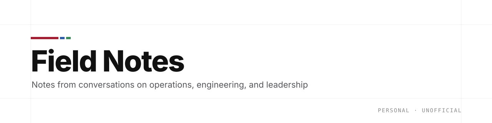

  <a href="https://allendiiaz.github.io/field-notes/">
    <picture>
      <source media="(prefers-color-scheme: dark)" srcset="assets/banner-dark.svg">
      <source media="(prefers-color-scheme: light)" srcset="assets/banner.svg">
      
    </picture>
  </a>

  
  
  

**Field Notes** is a personal series of bilingual (English / 中文) notes from conversations on operations, engineering, and leadership. Names of the people I spoke with are removed; the write-up is my own.

## Issues

| # | Title | Date | Link |
|:-:|---|:-:|:-:|
| 01 | What I Learned About MIT LGO from an Alum 從 LGO 校友身上學到的事 | 2026-10-08 | [Read →](https://allendiiaz.github.io/field-notes/issues/01-mit-lgo/) |

## How to read

Open an issue from the table above, or browse them all at **[allendiiaz.github.io/field-notes](https://allendiiaz.github.io/field-notes/)**. Each issue is a single page with English and 中文 side by side.
